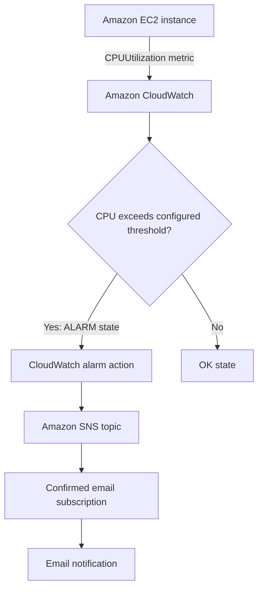

# AWS CloudWatch CPU Utilization Monitoring and Email Alerts

## Project Overview

This project monitors CPU utilization of an Amazon EC2 instance using
Amazon CloudWatch. A CloudWatch alarm evaluates CPU usage against a
configured threshold and publishes a notification to an Amazon SNS topic
when the alarm enters the `ALARM` state. SNS sends the notification to a
confirmed email subscription.

## Objectives

-   Monitor an EC2 instance's CPU utilization.
-   Create a CloudWatch alarm for high CPU usage.
-   Send email notifications through Amazon SNS.
-   Learn the basics of AWS monitoring and alerting.

## AWS Services Used

-   **Amazon EC2** --- virtual server whose CPU utilization is
    monitored.
-   **Amazon CloudWatch** --- collects and displays the `CPUUtilization`
    metric and evaluates the alarm.
-   **CloudWatch Alarm** --- changes state when the configured threshold
    condition is met.
-   **Amazon SNS** --- sends email notifications to confirmed
    subscribers.

## Architecture



A copy of the diagram source is also available in `architecture.mmd`.

## Configuration Used

The initial alarm configuration used for this project was: - Metric:
`CPUUtilization` - Statistic: Average - Period: 5 minutes - Condition:
Greater than 80% - Evaluation: 1 out of 1 datapoints within 5 minutes -
Alarm name: `High-CPU-Utilization-Alarm` - SNS topic:
`CPU-Alert-Topic` - AWS Region: Asia Pacific (Mumbai), `ap-south-1`

These values are examples of the configuration used during setup. Adjust
them if your alarm uses different settings.

## Setup Steps

### 1. Create an EC2 instance

1.  Sign in to the [AWS Management
    Console](https://console.aws.amazon.com/).
2.  Open **EC2** and choose **Launch instance**.
3.  Give the instance a name such as `CPU-Monitoring-Project`.
4.  Select an Amazon Linux image and an instance type appropriate for
    your account and budget.
5.  Review network and storage settings, then launch the instance.
6.  Wait until the instance is running and note its instance ID.

### 2. Create an SNS topic and email subscription

1.  Open the [Amazon SNS Console](https://console.aws.amazon.com/sns/).
2.  In the same AWS Region as the EC2 instance, create a **Standard**
    topic named `CPU-Alert-Topic`.
3.  Create an **Email** subscription using your email address.
4.  Open the subscription confirmation email and click **Confirm
    subscription**.

### 3. Create the CloudWatch alarm

1.  Open the [Amazon CloudWatch
    Console](https://console.aws.amazon.com/cloudwatch/).
2.  Choose **Alarms → All alarms → Create alarm**.
3.  Select **EC2 → Per-Instance Metrics** and choose your instance's
    `CPUUtilization` metric.
4.  Configure the statistic, period, threshold, and evaluation
    datapoints.
5.  Under alarm actions/notifications, select **In alarm** and choose
    `CPU-Alert-Topic`.
6.  Name the alarm `High-CPU-Utilization-Alarm` and create it.

### 4. Verify the setup

1.  Check that the alarm appears in CloudWatch.
2.  Confirm the SNS email subscription status is **Confirmed**.
3.  For an end-to-end test, cause the metric to cross the configured
    threshold on a test instance and wait for the alarm evaluation
    period.
4.  Check the email inbox and spam folder.
5.  Restore the intended threshold after testing.

**Note:** An `OK` alarm means the metric is currently within the
configured threshold. It does not by itself prove that an email alert
has been delivered. The email notification should be verified by testing
the alarm or publishing a test message to the SNS topic.

## Screenshots

Add your own AWS Console screenshots to the `screenshots/` folder and
update the list below. Before uploading, hide account IDs, email
addresses, instance IDs, public IP addresses, ARNs, and other details
you do not want public.

Suggested screenshots: 1. `01-ec2-instance.png` --- EC2 instance
running. 2. `02-sns-topic.png` --- SNS topic details. 3.
`03-sns-confirmed-subscription.png` --- confirmed subscription (hide the
email address). 4. `04-cloudwatch-alarm-ok.png` --- CloudWatch alarm in
`OK` state. 5. `05-cloudwatch-alarm-config.png` --- metric and threshold
configuration. 6. `06-email-alert.png` --- example notification email,
with personal details hidden.

## Repository Structure

``` text
aws-cloudwatch-cpu-alert/
├── README.md
├── architecture.mmd
├── screenshots/
│   └── README.md
└── .gitignore
```

## Security and Cost Notes

-   Never upload AWS access keys, secret keys, passwords, private key
    files (`.pem`), or credentials.
-   Avoid publishing account IDs, personal email addresses, ARNs, IP
    addresses, or other identifying console details in screenshots.
-   Check current AWS pricing and account eligibility before launching
    resources.
-   Stop or terminate test resources when they are no longer needed, and
    remove unused alarms or SNS resources if appropriate.

## Learning Outcomes

-   Created and monitored an EC2 instance.
-   Used the CloudWatch `CPUUtilization` metric.
-   Configured a threshold-based CloudWatch alarm.
-   Connected an alarm action to an SNS topic.
-   Configured an email subscription and learned how to verify
    notifications.

## Future Improvements

-   Create a CloudWatch dashboard for CPU utilization.
-   Add alarms for other metrics, such as status checks or memory
    utilization (memory metrics generally require the CloudWatch Agent).
-   Use AWS CloudFormation or Terraform to automate the setup.
